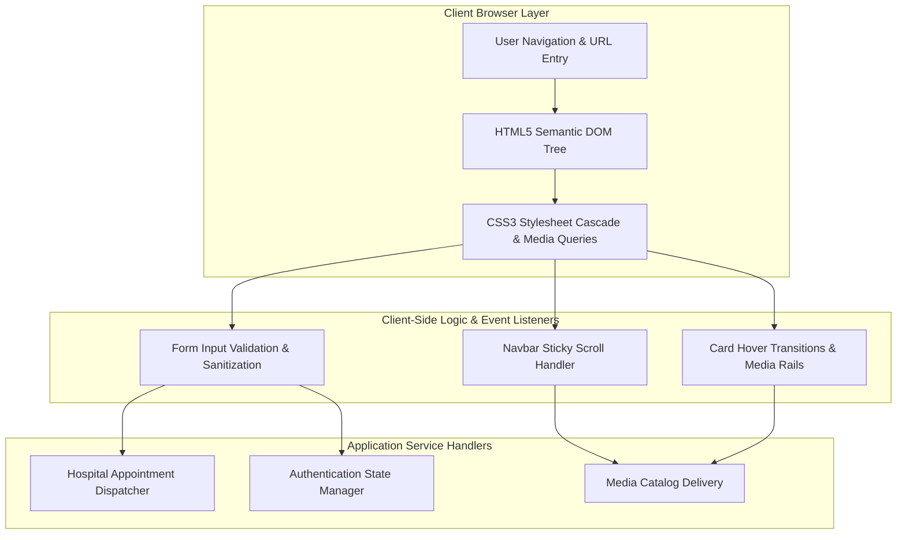

<div align="center">

<a href="https://github.com/akashvenkey/project-fsd">

</a>


### 🔗 **Project Source Link:** [https://github.com/akashvenkey/project-fsd](https://github.com/akashvenkey/project-fsd)

[](https://github.com/akashvenkey/project-fsd)
[](https://github.com/akashvenkey/project-fsd.git)

[](https://developer.mozilla.org/en-US/docs/Web/HTML)
[](https://developer.mozilla.org/en-US/docs/Web/CSS)
[](https://developer.mozilla.org/en-US/docs/Web/JavaScript)
[](#)
[](#)

</div>

---

## 📌 Executive Summary & Overview

Modern web software development requires mastering both interactive frontend presentation layers and robust data transaction models. From mission-critical healthcare scheduling workflows to high-engagement media entertainment portals, software engineers must balance clean visual semantics, responsive layouts, intuitive user accessibility, and client-side validation logic.

The **Full-Stack Web Suites** repository encapsulates core web engineering projects developed as part of Full Stack Development (FSD) academic and practical curricula. This suite documents the design and implementation of:
1. **City Hospital Management & Scheduling Portal:** A clinical interface allowing patients to browse medical departments, inspect doctor availability, and submit outpatient consultation bookings.
2. **Netflix Media Streaming Homepage Clone:** A modern, high-fidelity media catalog interface featuring hero video banners, responsive category rails, and responsive navbar transitions.
3. **Secure Authentication & Form Verification Modules:** Responsive login and user registration interfaces incorporating real-time input sanitization, error feedback, and credential validations.

---

## 📑 Interactive Table of Contents

- [📌 Executive Summary & Overview](#-executive-summary--overview)
- [✨ Key Features & Capabilities](#-key-features--capabilities)
- [💻 Module Deep-Dives](#-module-deep-dives)
- [🏗 System Architecture & Web Pipeline](#-system-architecture--web-pipeline)
- [🛠 Tech Stack Breakdown](#-tech-stack-breakdown)
- [🚀 Reproducible Quickstart & Setup](#-reproducible-quickstart--setup)
- [📂 Project Directory Layout](#-project-directory-layout)
- [👨‍💻 Author & Contributions](#-author--contributions)

---

## ✨ Key Features & Capabilities

- **🏥 Clinical Healthcare Directory:** Structured navigation allowing users to view cardiology, neurology, pediatrics, and emergency care services with dynamic doctor roster cards.
- **🎬 Entertainment Platform Aesthetics:** CSS Grid and Flexbox implementations replicating Netflix's dark-mode UI with fluid media cards, hover zoom transitions, and prominent CTA buttons.
- **🔐 Responsive Authentication Schemes:** Form layouts modeled after modern identity providers with responsive inputs, floating labels, and accessible focus states.
- **📱 Mobile-First Responsive Breakpoints:** Media queries providing seamless layout scaling from small mobile displays to wide desktop monitors.
- **⚡ Semantic HTML5 & Vanilla CSS Architecture:** Lightweight, dependency-free markup ensuring zero-overhead load times and rapid DOM rendering.

---

## 💻 Module Deep-Dives

### 1. Hospital Management Portal
Designed for clinical operations, this interface provides an emergency callout banner, department selection menus, doctor specialization profiles, and an interactive appointment reservation form capturing patient demographics and preferred consultation slots.

### 2. Netflix UI Clone
Recreates the iconic streaming experience featuring a fixed semi-transparent navigation header, responsive hero promotional section with "Get Started" email capture, and styled movie title cards arranged in horizontal scroll rails.

### 3. Authentication & Login Interfaces
Implements clean credentials collection interfaces with password masking, client-side input constraint enforcement, and styled button interaction feedback.

---

## 🏗 System Architecture & Web Pipeline

The following diagram illustrates the architecture and event flow across the full-stack web modules:



---

## 🛠 Tech Stack Breakdown

| Technology | Specification | Function in Application |
| :--- | :--- | :--- |
| **HTML5** | Semantic Standard | Content structuring, input fields, forms, and accessibility landmarks |
| **CSS3** | Modern Layout Engine | Flexbox, CSS Grid, media query breakpoints, transitions, and hover states |
| **JavaScript** | ECMAScript 6+ | DOM manipulation, form event handling, and client-side constraint checking |
| **Documentation** | PSPDFKit / PDF Modules | Academic project reviews, class test evaluations, and design blueprints |
| **Development** | VS Code & Chrome DevTools | Live Server preview, responsive screen simulation, and CSS debugging |

---

## 🚀 Reproducible Quickstart & Setup

### Prerequisites
- Modern Web Browser (Google Chrome, Microsoft Edge, Mozilla Firefox, or Safari)
- Optional: Lightweight HTTP server (`python -m http.server` or `npx serve`)

### Step-by-Step Setup
```bash
# 1. Clone the repository
git clone https://github.com/akashvenkey/project-fsd.git

# 2. Navigate to project root
cd project-fsd

# 3. View the academic documentation and project specifications
start "Akash+hospital+class+test+.pdf"
start "Netfliix_homepage_mini_project.pdf"
start "Akash_mimi_project3.pdf"
```

To run associated HTML web suites directly in your browser, check the companion [`projects`](https://github.com/akashvenkey/projects) repository:
```bash
git clone https://github.com/akashvenkey/projects.git
cd projects
# Serve static pages locally:
python -m http.server 8080
# Open http://localhost:8080/hospital.html
```

---

## 📂 Project Directory Layout

```plaintext
project-fsd/
├── Akash+hospital+class+test+.pdf     # Evaluation documentation on City Hospital management portal
├── Akash_mimi_project3.pdf            # Mini project report on web development and UI systems
├── Netfliix_homepage_mini_project.pdf # Technical specification and clone of Netflix homepage
└── README.md                          # Full-stack documentation and architecture guide
```

---

## 👨‍💻 Author & Contributions

**Akash V**  
- **GitHub:** [@akashvenkey](https://github.com/akashvenkey)  
- **Discipline:** Full Stack Web Development & Software Engineering  
- **Academic Program:** BCA (Hons), Alliance University, Bangalore  

Pull requests, design refinements, and issue reports are welcomed. If you find these project designs educational, please leave a ⭐!

---

<div align="center">

<a href="https://github.com/akashvenkey/project-fsd">

</a>


### 🔗 **Project Source Link:** [https://github.com/akashvenkey/project-fsd](https://github.com/akashvenkey/project-fsd)

[](https://github.com/akashvenkey/project-fsd)
[](https://github.com/akashvenkey/project-fsd.git)

</div>